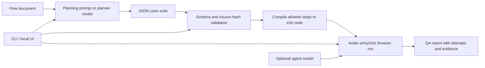

# Architecture and verification boundaries

The local CLI and loopback web UI share one workspace format, case schema, execution path, and report contract. Flow QA runs browser tests against a target URL; it does not need the target application's source code.

## Decisions at each boundary

**Planning and execution are separate.** A `planner` designs cases from a flow; an `agent` is used only for `act` and `assertAgent` steps during execution. They are configured independently. Users review the generated JSON before running it, and fixed steps run without either model. Users choose model and target addresses; authentication values come from named environment variables rather than the config JSON.

**Only a defined vocabulary compiles.** The schema checks requirement references, assertions, step types, and inputs. It does not execute arbitrary code or shell commands from model output. Cases with unresolved `questions`, or steps that need an unavailable agent model, are blocked. `preconditions` describe required state; they are not an automatic setup contract.

**Source and evidence stay linked.** Planning records the source flow's SHA-256 hash in the suite. `validate`, `generate`, and `run` check it again and stop when the flow changed. Each execution writes a new directory with a suite snapshot, generated tests, raw engine output, and Markdown/JSON reports. Previous evidence is not reused as a current success. `compare` permits a direct comparison only for the same suite hash and target URL; it cannot establish that external data was unchanged.

**Blocked and failed mean different things.** An unreachable app or unresolved question is blocked; an assertion mismatch is failed. A pass after retry has its own status. Engine output is validated rather than treating missing results as passes. The report records observations, not a root-cause verdict on the product.

## Ownership

| Area | Flow QA provides | External implementation or prerequisite |
| --- | --- | --- |
| Planning | Prompt, model connection, JSON schema validation | User-selected OpenAI-compatible model |
| Execution | Step compilation, target connection, orchestration, cancellation | [tester-army/e2e](https://github.com/tester-army/e2e), Chromium |
| Results | A fresh report per run, status interpretation, evidence links | Raw runs and evidence from the engine |
| UI | Local workflow screens and English/Korean language switch | [Hyeonse Design System](https://github.com/hyeonse-swing/hyeonse-design-system) tokens and preference utilities |

The UI binds only to `127.0.0.1` and serves approved report evidence, not arbitrary raw logs or HTML/SVG. Local reports may still contain data from the tested app and should be reviewed before sharing. This alpha does not manage login sessions, cap model spending, schedule CI runs, or support mobile devices.
